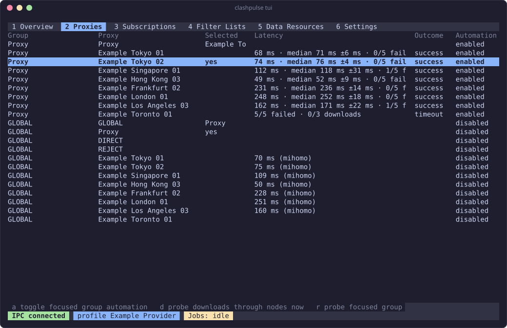

# A Mihomo client that switches only when it can prove it

ClashPulse is a lightweight cross-platform desktop client for
[Mihomo](https://github.com/MetaCubeX/mihomo). It measures every node in
the groups you automate, keeps a window of samples per node, and moves a
group only when a candidate is measurably better than the node it is on.
Every threshold is a setting you can see and change.

Written in Go. Fyne GUI, tcell TUI, strict TOML config, one binary for
Linux, macOS, and Windows. It is not a Clash Verge Rev feature clone or a
general-purpose proxy panel.


## Why ClashPulse

**Measure, then switch.** A switch needs evidence: the selected node is
unhealthy or over the threshold for the configured number of consecutive
samples, and a candidate is better by at least `min_improvement` on the
median of its window - never on a single fast sample. Cooldown, one switch
at a time per group, and a stop when every candidate fails keep a group
from oscillating. Three policies cover different traffic: Fastest,
Failover, and Steady stream. See [automatic switching](switching.html).

**Mihomo stays the data plane.** ClashPulse starts, stops, observes, and
configures a separate Mihomo process through its local controller API. It
does not fork or embed Mihomo, and no Mihomo binary is bundled: use your
distribution's package or point Settings at an executable.

**Low idle CPU.** No polling loops, no unconditional redraw timers, no
goroutine per item. Each monitor runs at its next deadline on a timer,
probes run in a small bounded worker pool, and results reach the UI as one
coalesced update per batch.

**Configuration as strict data.** Four shallow TOML files, each with one
purpose. Unknown keys, duplicate IDs, invalid values, and dangling
cross-file references are load errors, not silently ignored typos. A hand
edit reloads only once the whole file set validates; a bad edit keeps the
running configuration. See [configuration](configuration.html).

**One service, three clients.** One ClashPulse service per machine owns
Mihomo, the monitor, and every download. The GUI window, any number of
`clashpulse tui` sessions, and the CLI commands are clients of that
service over a private local IPC channel - same commands, same state.

**Private by construction.** Mihomo's controller sits on a Unix socket in a
0700 directory (on Windows, a random loopback port with a random secret);
subscription URLs, secrets, and proxy credentials never cross IPC; private
state lives in 0700 directories and 0600 files. See
[privacy and security](security.html).



## Quick start

1. [Install](installation.html) ClashPulse and Mihomo, with `mihomo` on
   `PATH`.
2. Start the GUI:

   ```sh
   ./clashpulse
   ```

3. Add an HTTPS subscription, refresh it to fetch and validate the
   candidate profile, then activate it.
4. Optionally, in a second terminal, attach the TUI to the running service:

   ```sh
   ./clashpulse tui
   ```

On Windows use `.\clashpulse.exe` and `.\clashpulse.exe tui`. First start
seeds the four config files in the platform config directory
(`~/.config/clashpulse` on Linux unless `$XDG_CONFIG_HOME` is set).
Continue with [usage](usage.html).

## Status

ClashPulse is pre-release: v0.1.1 ships unsigned native builds for Linux
(amd64), macOS (Apple silicon), and Windows (amd64). The working name is
still under review. The [FAQ](faq.html) covers both.
