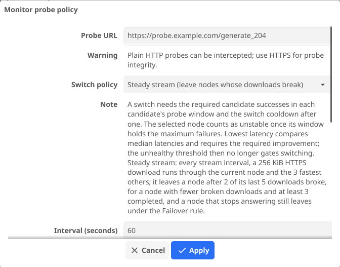

# Automatic switching

ClashPulse switches only managed `select` groups you opt in: GUI Proxies >
Enable group automation, TUI Proxies `a`, or `automated_groups`. Picking a
node by hand removes the opt-in.

Mihomo's `url-test` and `fallback` groups belong to Mihomo. ClashPulse never
probes or switches them; `url_test_interval` and `url_test_tolerance` only set
their delay settings.

## Policies

Set `switch_policy` in `[monitor]`, GUI Settings > Monitor, or TUI Settings
`y`.

Fastest (`lowest_latency`, default) moves to a node whose median latency is
lower by at least `min_improvement`. A fast answer does not mean a node holds
long downloads.

Failover (`failover`) stays put until the current node fails or exceeds
`threshold` for `consecutive_bad_samples` rounds.

Steady stream (`steady_stream`) downloads a 256 KiB HTTPS file every
`stream_interval` through the current node and the 3 fastest others. It
leaves a node after 2 of its last 5 downloads broke (reset, stalled, or cut
short), for one with fewer breaks and at least 3 completed downloads. That is
about 12 MB per hour per group, at most 24 MB. A node that stops answering
latency probes still leaves under the Failover rule. It needs a Mihomo with
pinned listener support (verified with v1.19.31).

All policies respect cooldown and manual selection, and stop switching when
every candidate fails. Probes go through Mihomo's delay endpoint, the same
path as your traffic; a timeout or error is a failed sample.

## Monitor settings

| key | default | meaning | TUI |
| --- | --- | --- | --- |
| `enabled` | `true` | measure managed groups | `m` / `n` |
| `test_url` | `http://cp.cloudflare.com/generate_204` | latency probe URL | `u` |
| `switch_policy` | `"lowest_latency"` | or `failover`, `steady_stream` | `y` |
| `stream_url` | `https://speed.cloudflare.com/__down?bytes=262144` | Steady stream file | `O` |
| `stream_interval` | `"5m"` | between download rounds | `I` |
| `interval` | `"1m"` | between latency rounds; a switch needs three | `i` |
| `timeout` | `"5s"` | per probe | `o` |
| `concurrency` | `3` | parallel probes, at most 64 | `c` |
| `threshold` | `"800ms"` | latency that counts as bad | `h` |
| `alert_threshold` | `"250ms"` | notify if every candidate is slower | `t` |
| `window_size` | `5` | samples kept per node (2-20) | `W` |
| `consecutive_bad_samples` | `3` | bad samples before failover | `s` |
| `min_candidate_samples` | `3` | successes a candidate needs | `C` |
| `max_failures` | `2` | failures that mark a node unstable | `f` |
| `min_improvement` | `"100ms"` | required median gain | `p` |
| `cooldown` | `"5m"` | between switches of one group | `z` |
| `jitter` | `"10s"` | spread within a round | `w` |
| `automated_groups` | `[]` | groups switched automatically | Proxies `a` |

`max_failures` Mihomo dial failures in a probed group also trigger an early
probe, at most every 15s.

The default `test_url` is plain HTTP and can be intercepted. Use HTTPS if
probe integrity matters. TUI `T` or the Monitor section sends a test
notification.
