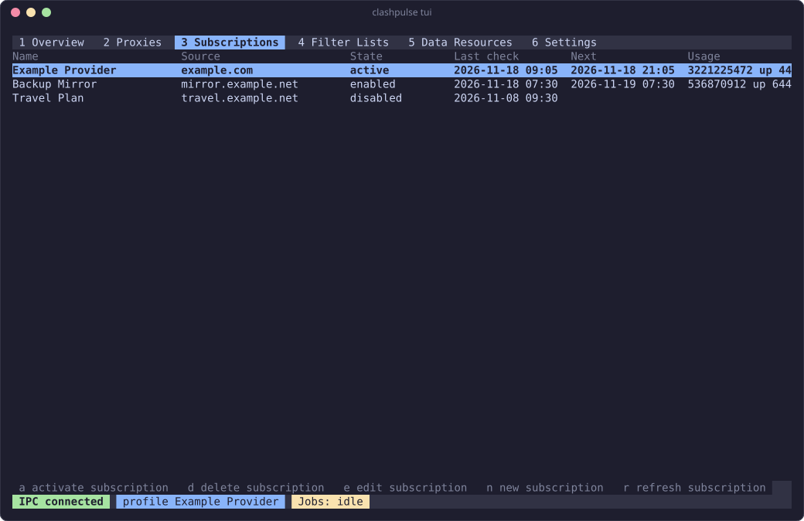

# Usage

One ClashPulse service per machine owns Mihomo, the monitor, and every
download. The GUI, TUI, and CLI talk to it over local IPC.

`./clashpulse` starts the service and opens the window, or attaches the
window to a service that already runs. A second window refuses to start.
Closing the window leaves running a service it did not start.

`./clashpulse tui` attaches to a running service and never starts one. Any
number of TUIs can attach.

The interface is Simplified Chinese when the OS locale is `zh-CN` (also
`zh_CN.UTF-8` and `zh-Hans-CN`), English otherwise.

## GUI

The sidebar switches pages. The top bar shows whether traffic goes through
Mihomo, with pills for Mihomo, the system proxy, and TUN. Its menu (the dots
at the right) starts, stops, and restarts the service, reloads the config, and
opens the activity view.

Overview cards show the current node with its latency, the steady-stream
download results, the last switch with its reason and evidence, subscription
usage, and health. The activity view (top-bar menu or the Health card) lists
this session's sanitized diagnostics and the fields ClashPulse added,
replaced, or removed in the active profile, with a reason but no values.

Proxies shows median latency, jitter, and failures per node for the chosen
group. Enable group automation opts a managed `select` group into switching;
picking a node by hand turns it off. Probe group runs a latency round now.
Probe downloads runs a Steady stream round and needs that policy active.

On Subscriptions, Refresh downloads and validates a new snapshot without
touching the running profile; Activate applies it. Filter Lists and Data
Resources work the same way. See [subscriptions and data](sources.html).

| Settings section | contents |
| --- | --- |
| Mihomo binary | system, bundled, or a path; version and capabilities |
| System Proxy | on/off, mixed port on 127.0.0.1, mode Rule, Global, or Direct |
| TUN | Linux only; all host traffic through Mihomo's TUN device |
| Monitor | switch policy and probe settings; see [automatic switching](switching.html) |
| DNS | listener, resolver sets, routes |

The tray menu picks a node in an active managed `select` group and toggles
the system proxy.

## TUI

Keys `1` to `6` select the same six views. `?` shows key help (`F1` in
editors), `~` the session log; `q` closes either.

Default keys from `tui/keys.toml`:

| where | keys |
| --- | --- |
| everywhere | `q` / `ctrl+c` quit, `?` help, `tab` / `shift+tab` next/previous tab, `up` / `k` and `down` / `j` move, `enter` activate, `esc` close modal, `1`-`6` views, `~` session log |
| Overview | `s` start, `x` stop, `r` reload configuration |
| Proxies | `r` probe focused group, `a` toggle automation, `d` probe downloads |
| Subscriptions | `r` refresh, `a` activate, `n` new, `e` edit, `d` delete |
| Filter Lists, Data Resources | `r` refresh, `n` new, `e` edit |
| Settings | `b` Mihomo binary, `r` reload configuration |
| Settings: System Proxy | `e` / `d` enable/disable, `P` mixed port, `R` cycle mode |
| Settings: Monitor | `m` / `n` enable/disable, `y` cycle policy, `T` test notification, the rest in [monitor settings](switching.html#monitor-settings) |
| Settings: DNS | `l` listener, `v` add resolver set, `a` add route, `g` edit, `x` remove |
| Settings: TUN | `U` / `D` enable/disable, `A` authorize, `S` stack, `M` DNS mode |
| forms | `up` / `down` field, `space` toggle, `enter` edit, `left` / `right` choice or character, `backspace` delete, `ctrl+s` / `f2` save, `esc` cancel, `f1` help |
| dialogs | `enter` apply, `esc` cancel, `f1` help |
| session log | `up` / `k`, `down` / `j`, `pgup` / `pgdown`, `home` / `end` scroll, `q` close, `?` help |
| help | `up` / `down`, `pgup` / `pgdown`, `home` / `end` scroll, `q` / `esc` close |

## CLI

| command | action |
| --- | --- |
| `clashpulse [gui]` | run the GUI |
| `clashpulse tui` | attach the TUI |
| `clashpulse version` | print the version |
| `clashpulse activate <profile.yaml>` | run a local profile until Ctrl-C |
| `clashpulse download subscription [id]` | download without activating |
| `clashpulse refresh` | refresh everything and validate the generated config |
| `clashpulse refresh subscription [id]` | refresh subscriptions |
| `clashpulse refresh resource [id]` | refresh resources |

Without an ID, a command handles every enabled source.

`activate` reads the file once, validates it, and prints
`local profile active; press Ctrl-C to stop` when the controller is ready.
The TUI can attach meanwhile. Ctrl-C stops Mihomo and turns the
[system proxy](security.html#system-proxy) off. The file is never edited, its
path never shows in errors, and the generated config is deleted on shutdown.

With the desktop running, `download` and `refresh` hand the work to its
service, which validates but never activates. Otherwise they do the work
themselves. `--show-response` prints up to 4 KiB of the HTTP response to
stderr on failure; it needs the desktop closed.
