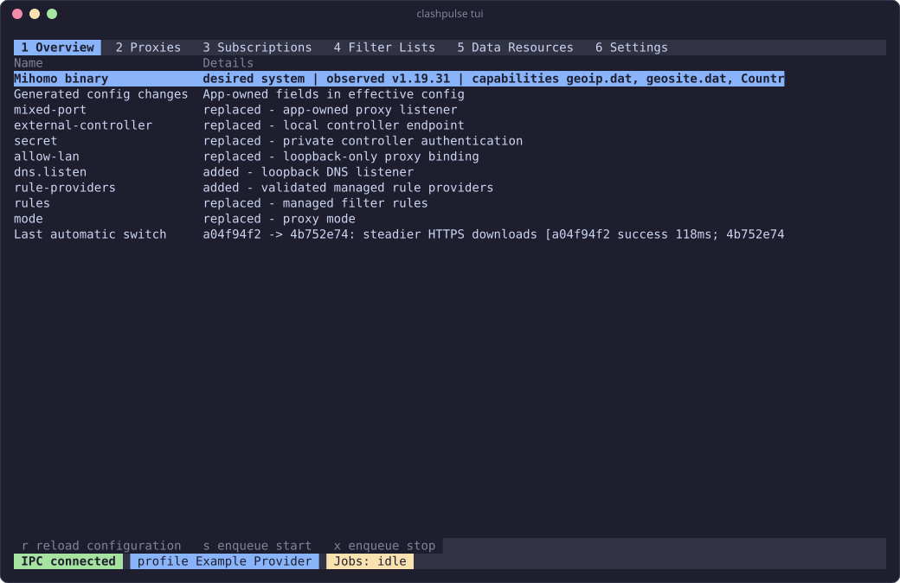
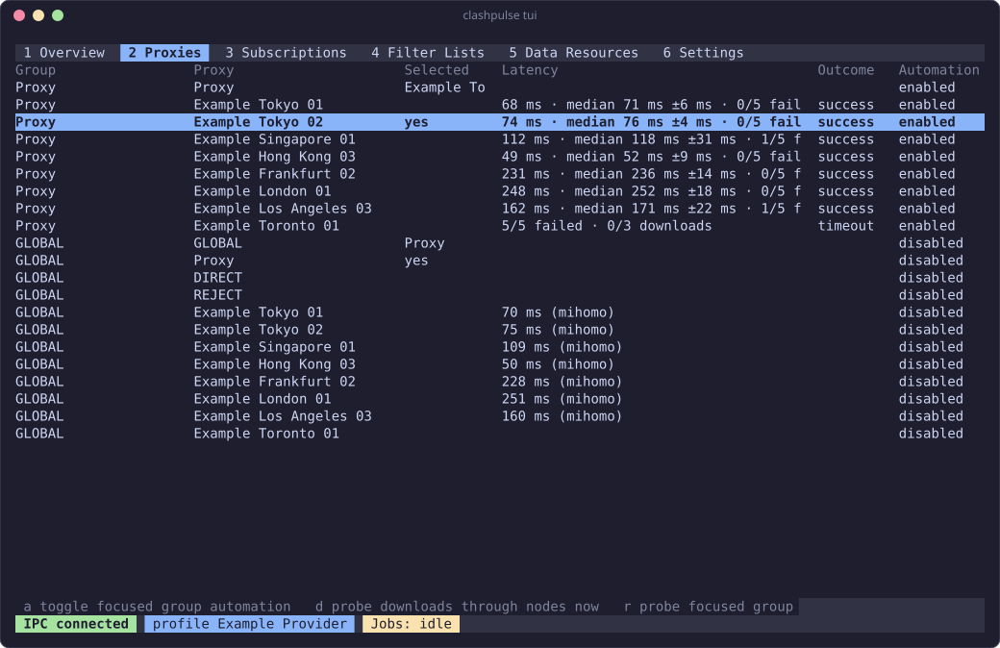
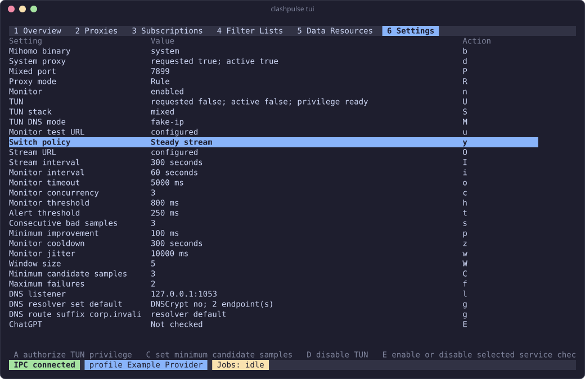

# Usage

## One service, many clients

There is one ClashPulse service and one ClashPulse window per machine. The
service owns Mihomo, the monitor, the scheduler, and every download; the
GUI, the TUI, and the CLI talk to it over local IPC.

- `./clashpulse` starts the service and opens the window. If a service
  already runs (started by the GUI, `clashpulse tui`, or `clashpulse
  activate`), it opens the window against that service instead of starting
  a second one. If a window already runs, it reports that and exits.
- Closing the window leaves a service it did not start running.
- `./clashpulse tui` attaches to the running service and never starts one
  itself; with no service running it reports an error. Any number of TUI
  sessions may attach.

The GUI, TUI, and CLI use Simplified Chinese when the operating-system
locale is `zh-CN` (including `zh_CN.UTF-8` and `zh-Hans-CN`); other locales
use English.

## GUI

The window has six views: Overview, Proxies, Subscriptions, Filter Lists,
Data Resources, and Settings. A tray menu mirrors the common controls.

### Overview


Service state and counts, the selected Mihomo binary, the latest automatic
switch, and the last error. Buttons start, stop, and restart the service,
reload the configuration from disk, and open **View activity** - a
scrollable log of sanitized IPC diagnostics for the current session, never
subscription URLs or credentials.

**Generated config changes** lists each app-managed field of the active
profile that ClashPulse added, replaced, or removed, with a fixed reason.
It is not a full YAML diff: it carries no source or generated values,
credentials, network endpoints, or URLs. A stopped service shows no
report.

### Proxies


Pick a proxy group, then:

- **Enable group automation** opts a managed `select` group into automatic
  switching. Selecting a node by hand turns automation off for that group
  until you re-enable it.
- **Probe group** runs a latency round for the group now.
- **Probe downloads** runs a Steady stream download round now; it is
  enabled only while a connected service runs the Steady stream policy.

Each node row shows its measurements over the stability window: median
latency, jitter, and failure count. The active node is marked.

### Subscriptions


**Add subscription** opens the editor. Each row has Refresh, Activate,
Edit, Details, and Delete. Refresh downloads and validates a new snapshot
without touching the running profile; Activate applies it. See
[subscriptions and data](sources.html).

### Filter Lists and Data Resources

Both views list their entries with Refresh, Edit, and Details, plus an Add
button. Filter lists route a managed rule-set to a group of the active
profile; data resources are the GeoIP, GeoSite, MMDB, and rule-set files
Mihomo reads.

### Settings


Settings has Mihomo binary, System Proxy, TUN, Monitor, and DNS sections.
Its sidebar becomes a dropdown when the sidebar and the selected section
cannot fit side by side.

- **Mihomo binary**: use the system Mihomo, the bundled one, or choose an
  executable path; shows the observed version, capabilities, and the last
  compatibility failure.
- **System Proxy**: enable or disable the OS proxy setting, the mixed port
  (HTTP, HTTPS, and SOCKS on 127.0.0.1), and the proxy mode (Rule, Global,
  Direct).
- **TUN** (Linux): routes all host traffic through Mihomo's TUN device.
- **Monitor**: switch policy and probe settings, the Mihomo url-test delay,
  and a test notification. See [automatic switching](switching.html).
- **DNS**: the DNS listener, resolver sets, and DNS routes.

### Tray

The tray's Proxies menu selects a member of an active managed `select`
group; its System Proxy item changes the requested OS setting. Controls
return when the local IPC service reconnects.

## TUI



```sh
./clashpulse tui
```

The TUI has the same six views as the GUI, on number keys `1` to `6`.
Press `?` for keyboard help (`F1` inside editors) or `~` for the
current-session activity log; `q` closes either overlay without quitting.
The help overlay derives from the same binding map as the hints below.






### Keys

These are the defaults from `tui/keys.toml`, one table per context.

#### Global (every view)

| key | action |
| --- | --- |
| `q` / `ctrl+c` | quit |
| `?` | show keyboard help |
| `tab` | next tab |
| `shift+tab` | previous tab |
| `up` / `k` | move up |
| `down` / `j` | move down |
| `enter` | activate |
| `esc` | close modal |
| `1` | Overview |
| `2` | Proxies |
| `3` | Subscriptions |
| `4` | Filter Lists |
| `5` | Data Resources |
| `6` | Settings |
| `~` | toggle session log |

#### Overview

| key | action |
| --- | --- |
| `s` | enqueue start |
| `x` | enqueue stop |
| `r` | reload configuration |

#### Proxies

| key | action |
| --- | --- |
| `r` | probe focused group |
| `a` | toggle focused group automation |
| `d` | probe downloads through nodes now |

#### Subscriptions

| key | action |
| --- | --- |
| `r` | refresh subscription |
| `a` | activate subscription |
| `n` | new subscription |
| `e` | edit subscription |
| `d` | delete subscription |

#### Filter Lists

| key | action |
| --- | --- |
| `r` | refresh filter |
| `n` | new filter |
| `e` | edit filter |

#### Data Resources

| key | action |
| --- | --- |
| `r` | refresh resource |
| `n` | new resource |
| `e` | edit resource |

#### Settings

| key | action |
| --- | --- |
| `e` | enable system proxy |
| `d` | disable system proxy |
| `P` | set mixed proxy port |
| `R` | cycle proxy mode |
| `m` | enable monitor |
| `n` | disable monitor |
| `b` | select Mihomo binary |
| `i` | set monitor interval |
| `t` | set alert threshold in milliseconds |
| `r` | reload configuration |
| `u` | set monitor test URL |
| `o` | set monitor timeout in milliseconds |
| `c` | set monitor concurrency |
| `h` | set monitor latency threshold in milliseconds |
| `s` | set consecutive bad samples |
| `p` | set minimum improvement in milliseconds |
| `z` | set monitor cooldown in seconds |
| `w` | set monitor jitter in milliseconds |
| `W` | set stability window size |
| `C` | set minimum candidate samples |
| `f` | set maximum failures in window |
| `y` | cycle switch policy |
| `O` | set stream test URL |
| `I` | set stream interval in seconds |
| `T` | send test notification |
| `l` | set DNS listener |
| `v` | add DNS resolver set |
| `a` | add DNS route |
| `g` | edit selected DNS entry |
| `x` | remove selected DNS entry |
| `U` | enable TUN |
| `D` | disable TUN |
| `A` | authorize TUN privilege |
| `S` | set TUN stack |
| `M` | set TUN DNS mode |

#### Forms (editors)

| key | action |
| --- | --- |
| `up` | previous field |
| `down` | next field |
| `space` | toggle field |
| `enter` | edit field |
| `left` | previous choice or character |
| `right` | next choice or character |
| `backspace` | delete character |
| `ctrl+s` / `f2` | save form |
| `esc` | cancel form |
| `f1` | show form help |

#### Dialogs

| key | action |
| --- | --- |
| `enter` | apply |
| `esc` | cancel |
| `f1` | show dialog help |

#### Session log (`~`)

| key | action |
| --- | --- |
| `up` / `k` | older diagnostic |
| `down` / `j` | newer diagnostic |
| `pgup` | older page |
| `pgdown` | newer page |
| `home` | oldest diagnostic |
| `end` | newest diagnostic |
| `q` | close log |
| `?` | show log help |

#### Help overlay (`?`)

| key | action |
| --- | --- |
| `up` | previous binding |
| `down` | next binding |
| `pgup` | previous page |
| `pgdown` | next page |
| `home` | first binding |
| `end` | last binding |
| `q` / `esc` | close help |

## CLI

| command | action |
| --- | --- |
| `clashpulse` / `clashpulse gui` | run the desktop GUI |
| `clashpulse tui` | connect the terminal UI to the desktop service |
| `clashpulse version` | print the version |
| `clashpulse activate <profile.yaml>` | run a local profile until interrupted |
| `clashpulse download subscription [id]` | download subscription profiles without activating them |
| `clashpulse refresh` | refresh subscriptions and resources, then validate the generated config |
| `clashpulse refresh subscription [id]` | refresh all enabled subscriptions, or one by ID |
| `clashpulse refresh resource [id]` | refresh all enabled resources, or one by ID |

Without an ID, each command handles all enabled sources in its scope.

### Running a local profile

```sh
./clashpulse activate 'my profile.yaml'
```

The command reads the file once, validates it with the selected Mihomo, and
prints `local profile active; press Ctrl-C to stop` only after the
controller is ready. It owns the same local IPC service, so the TUI can
connect while it runs. Ctrl-C stops Mihomo and turns the System Proxy off
(see [privacy and security](security.html#system-proxy) for what that
means per platform). The source file is never edited or imported as a
subscription, and activation errors never include its path. The
private generated config is removed on shutdown. Activation failures print a
fixed, credential-safe stage and exit nonzero.

### Downloads and refreshes

With the desktop running, `download` and `refresh` hand the work to its
service and print each failure; the service validates what it downloads and
never activates it. With no service running they take the private-state
lock and work directly.

Add `--show-response` to print up to 4 KiB of printable HTTP response text
to local stderr on failure. It needs the desktop closed, because response
bodies never leave the service. URLs and response bodies stay hidden by
default.
