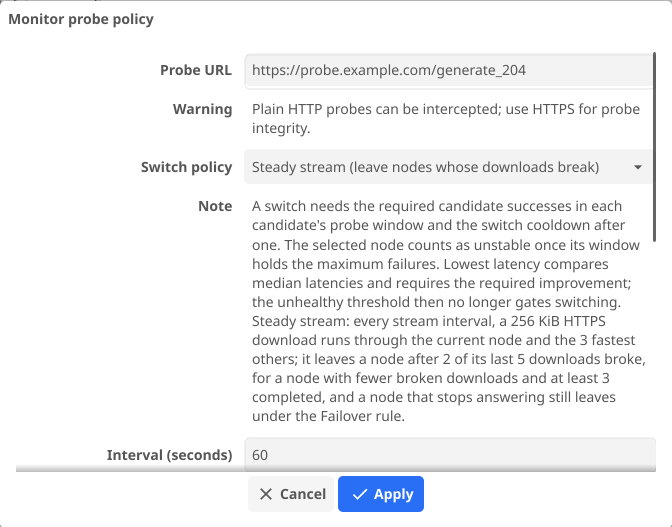

# 自动切换

ClashPulse 只切换你开启了自动切换的托管 `select` 组：GUI 代理 > 启用组自动切换、TUI 代理页按 `a`，或写进 `automated_groups`。手动选节点会取消该组的自动切换。

Mihomo 自己的 `url-test` 和 `fallback` 组归 Mihomo 管。ClashPulse 从不测速也不切换它们；`url_test_interval` 和 `url_test_tolerance` 只设置这些组的测速参数。

## 切换策略

在 `[monitor]` 的 `switch_policy`、GUI 设置 > 延迟监测，或 TUI 设置页按 `y` 修改。

最快（`lowest_latency`，默认）：切到延迟中位数至少低 `min_improvement` 的节点。响应快不代表节点能撑住长时间下载。

故障切换（`failover`）：当前节点失效，或连续 `consecutive_bad_samples` 轮超过 `threshold` 之前不动。

稳定流（`steady_stream`）：每隔 `stream_interval`，通过当前节点和另外 3 个最快的节点下载一个 256 KiB 的 HTTPS 文件。某节点最近 5 次下载中断 2 次（被重置、卡住或被截断）后，换到中断更少且至少完成 3 次的节点。每个组每小时约 12 MB，最多 24 MB。节点不再响应延迟探测时，仍按故障切换规则离开。需要支持固定监听器的 Mihomo（v1.19.31 已验证）。

所有策略都遵守冷却时间和手动选择；全部候选都失败时停止切换。探测走 Mihomo 的延迟接口，和你的流量同一条路径；超时或出错记为失败样本。

## 监测设置 {#monitor-settings}

| 键 | 默认值 | 含义 | TUI |
| --- | --- | --- | --- |
| `enabled` | `true` | 测量托管组 | `m` / `n` |
| `test_url` | `http://cp.cloudflare.com/generate_204` | 延迟探测 URL | `u` |
| `switch_policy` | `"lowest_latency"` | 或 `failover`、`steady_stream` | `y` |
| `stream_url` | `https://speed.cloudflare.com/__down?bytes=262144` | 稳定流下载的文件 | `O` |
| `stream_interval` | `"5m"` | 两轮下载之间的间隔 | `I` |
| `interval` | `"1m"` | 两轮延迟探测之间的间隔；切换至少要三轮 | `i` |
| `timeout` | `"5s"` | 单次探测超时 | `o` |
| `concurrency` | `3` | 并发探测数，最多 64 | `c` |
| `threshold` | `"800ms"` | 超过即算异常的延迟 | `h` |
| `alert_threshold` | `"250ms"` | 所有候选都更慢时才通知 | `t` |
| `window_size` | `5` | 每个节点保留的样本数（2-20） | `W` |
| `consecutive_bad_samples` | `3` | 故障切换前的连续异常样本数 | `s` |
| `min_candidate_samples` | `3` | 候选节点需要的成功次数 | `C` |
| `max_failures` | `2` | 判定节点不稳定的失败次数 | `f` |
| `min_improvement` | `"100ms"` | 中位数至少要改善多少 | `p` |
| `cooldown` | `"5m"` | 同一组两次切换的最短间隔 | `z` |
| `jitter` | `"10s"` | 在一轮内错开探测 | `w` |
| `automated_groups` | `[]` | 自动切换的组 | 代理页 `a` |

一个被探测的组里出现 `max_failures` 次 Mihomo 拨号失败，也会提前触发探测，最多每 15 秒一次。

默认 `test_url` 是明文 HTTP，可能被劫持。如果在意探测结果的完整性，请换成 HTTPS。TUI 按 `T` 或在延迟监测分节里可以发送测试通知。

## 服务检测 {#service-checks}

有些服务按地区拒绝节点；节点再快也可能被拒。服务检测通过节点读取一小段响应，报告 `usable`（可用）、`blocked`（被拒）或 `error`（检测失败），并给出检测到的地区。默认不启用任何服务。在 `config.toml` 的 `[[service]]`、GUI 设置 > 服务检测，或 TUI 设置页（在服务行按 `Enter` 编辑）中配置。

每个启用的服务都有一个 `select` 组 `ClashPulse - <名称>`，包含配置中的全部代理，并有 `DOMAIN-SUFFIX` 规则把该服务的域名发往这个组，排在配置自身规则之前。`domains_resource` 用一条指向已启用域名规则集资源的 `RULE-SET` 规则替换这些域名。配置里已有同名 `ClashPulse - <名称>` 组时报错；ClashPulse 从不自动改名。

| 服务 | ID | 检测 | 可用条件 |
| --- | --- | --- | --- |
| ChatGPT | `chatgpt` | `https://chat.openai.com/cdn-cgi/trace`、`https://api.openai.com/compliance/cookie_requirements` | 第二个响应为 2xx 且不含 `unsupported_country` |
| Claude | `claude` | `https://claude.ai/cdn-cgi/trace` | 地区不在 Claude 的拒绝列表中 |
| Gemini | `gemini` | 复用 YouTube 的读取 | Google 判定的国家不在 Gemini 的拒绝列表中 |
| YouTube Premium | `youtube` | `https://www.youtube.com/premium?hl=en`（前 96 KiB） | 读到国家且没有“not available in your region”提示 |
| Netflix | `netflix` | 三个 `https://www.netflix.com/title/...` 页面，只看响应头 | 有片目可看且没有被拒绝 |
| Spotify | `spotify` | `https://www.spotify.com/api/content/v1/country-selector?platform=web&format=json` | 2xx 且不含“not available in your country” |

每次检测都使用校验证书的 HTTPS，限时 15 秒，只跟随指向该服务自身域名的重定向，并使用全新的内存 Cookie。只保留结果和地区。六个服务都按默认间隔检测，每小时约 0.3 MB。

限制：如果 YouTube 把地区提示放在前 96 KiB 之后，检测只依据国家判断，可能报告可用。

| 键 | 默认值 | 含义 | TUI |
| --- | --- | --- | --- |
| `id` | | `chatgpt`、`claude`、`gemini`、`youtube`、`netflix`、`spotify`；每个最多一次 | |
| `enabled` | `false` | 生成该组并检测 | `E` |
| `regions` | `[]` | 首选的两位国家代码；为空表示任何未被拒绝的地区 | `Enter` |
| `check_interval` | `"30m"` | 两次检测所选节点的间隔；至少 `5m` | `Enter` |
| `failures` | `2` | 开始寻找新节点前的连续失败次数（1-10） | `Enter` |
| `automatic` | `false` | 允许 ClashPulse 切换该服务的组 | `G` |
| `domains_resource` | `""` | 替换内置域名的域名规则集资源 | `Enter` |

TUI 按 `K`（GUI 立即检测）会马上检测所选节点。组内节点变化时也会检测。

服务切换与组自动切换相互独立。服务组从不做延迟探测，`automated_groups` 也不能包含它们。`automatic = true` 时，组内节点连续 `failures` 次检测失败才会切换：`blocked` 计入；`error` 只有在该节点最近一次延迟探测也失败时才计入。搜索最多检测 8 个其他节点，按延迟顺序每次 4 个，选出 `regions` 内最快的可用节点。它遵守 `[monitor]` 的 `cooldown`，同一时间只切换一次。没有可用候选时保留当前节点，下次搜索等到下次检测。在服务组里手动选节点会关闭该服务的 `automatic`。

检测和稳定流下载共用 4 个私有回环探测监听器，因此服务检测需要支持固定监听器的 Mihomo（v1.19.31 已验证）。
