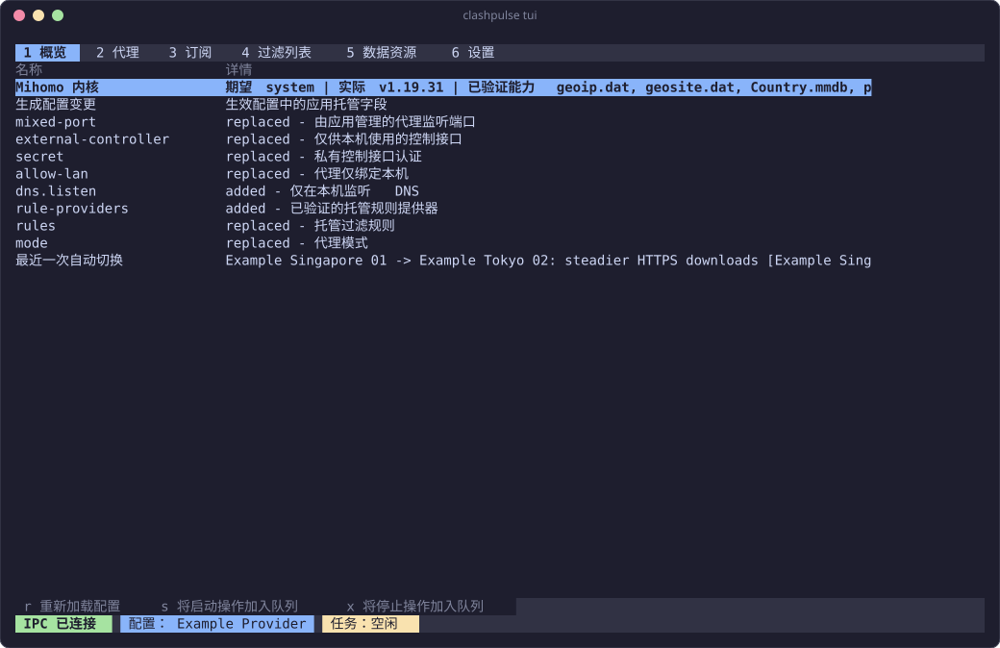
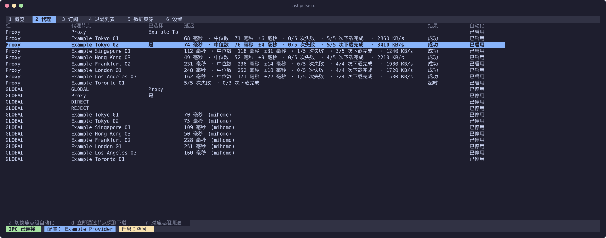
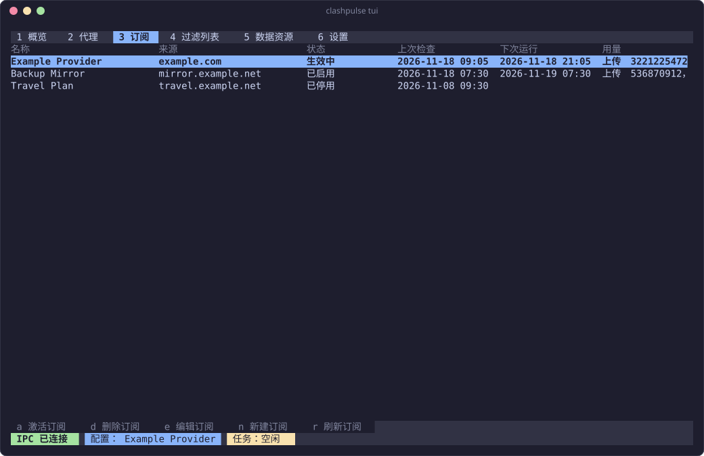
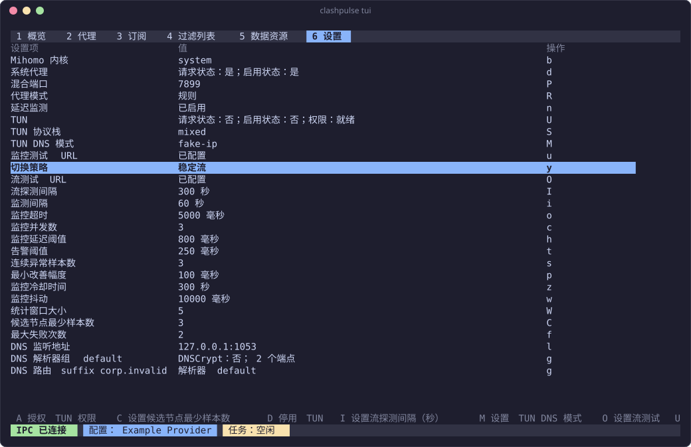

# 使用

每台机器只有一个 ClashPulse 服务，负责 Mihomo、延迟监测和所有下载。GUI、TUI 和命令行都通过本地 IPC 连接它。

`./clashpulse` 启动服务并打开窗口；如果服务已经在运行，窗口直接连上去。已有窗口时不会再开第二个。关闭窗口不会停止不是它启动的服务。

`./clashpulse tui` 只连接已运行的服务，自己从不启动服务，可以同时开任意多个。

操作系统区域设置为 `zh-CN`（包括 `zh_CN.UTF-8`、`zh-Hans-CN`）时界面显示简体中文，其他情况为英文。

## GUI

左侧边栏切换页面。顶栏显示流量是否经过 Mihomo，并用标记显示 Mihomo、系统代理和 TUN 的状态。顶栏右侧的菜单（三个点）可以启动、停止、重启服务，重新加载配置，以及打开活动记录。

概览用卡片显示当前节点及其延迟、稳定流下载结果、最近一次切换及原因和测量依据、订阅用量和健康状态。活动记录（顶栏菜单或“健康状态”卡片）列出本次会话中经过脱敏的诊断信息，以及 ClashPulse 在当前配置里添加、替换或移除的字段及原因，不含具体值。

代理页显示所选组每个节点的延迟中位数、抖动和失败次数。“启用组自动切换”让托管的 `select` 组参与自动切换；手动选节点会关掉它。“测试组延迟”立即测一轮延迟。“探测下载”立即跑一轮稳定流下载，只在稳定流策略生效时可用。

订阅页里，“刷新”下载并校验新快照，不影响正在运行的配置；“启用”才会应用它。过滤列表和数据资源的用法相同。见[订阅与数据](sources.html)。

| 设置分节 | 内容 |
| --- | --- |
| Mihomo 内核 | 系统、内置或指定路径；版本和能力 |
| 系统代理 | 开关、127.0.0.1 上的混合端口、代理模式（规则、全局、直连） |
| TUN | 仅 Linux；主机全部流量经 Mihomo 的 TUN 网卡 |
| 延迟监测 | 切换策略和探测设置，见[自动切换](switching.html) |
| DNS | 监听地址、解析器组、DNS 路由 |

托盘菜单可以在已激活的托管 `select` 组里选节点，也可以开关系统代理。

## TUI

按 `1` 到 `6` 切换同样的六个视图。`?` 显示键盘帮助（编辑器里是 `F1`），`~` 显示会话日志，`q` 关闭它们而不退出。

默认按键来自 `tui/keys.toml`：

| 位置 | 按键 |
| --- | --- |
| 全局 | `q` / `ctrl+c` 退出，`?` 帮助，`tab` / `shift+tab` 下一个/上一个标签页，`up` / `k`、`down` / `j` 移动，`enter` 激活，`esc` 关闭对话框，`1`-`6` 视图，`~` 会话日志 |
| 概览 | `s` 启动，`x` 停止，`r` 重新加载配置 |
| 代理 | `r` 对焦点组测速，`a` 切换焦点组自动化，`d` 立即通过节点探测下载 |
| 订阅 | `r` 刷新，`a` 激活，`n` 新建，`e` 编辑，`d` 删除 |
| 过滤列表、数据资源 | `r` 刷新，`n` 新建，`e` 编辑 |
| 设置 | `b` 选择 Mihomo 内核，`r` 重新加载配置 |
| 设置：系统代理 | `e` / `d` 启用/停用，`P` 混合端口，`R` 切换代理模式 |
| 设置：延迟监测 | `m` / `n` 启用/停用，`y` 轮换切换策略，`T` 发送测试通知，其余见[监测设置](switching.html#monitor-settings) |
| 设置：DNS | `l` 监听地址，`v` 添加解析器组，`a` 添加路由，`g` 编辑，`x` 移除 |
| 设置：TUN | `U` / `D` 启用/停用，`A` 授权 TUN 权限，`S` 协议栈，`M` DNS 模式 |
| 表单 | `up` / `down` 字段，`space` 切换，`enter` 编辑，`left` / `right` 选项或字符，`backspace` 删除字符，`ctrl+s` / `f2` 保存，`esc` 取消，`f1` 帮助 |
| 对话框 | `enter` 应用，`esc` 取消，`f1` 帮助 |
| 会话日志 | `up` / `k`、`down` / `j`、`pgup` / `pgdown`、`home` / `end` 滚动，`q` 关闭，`?` 帮助 |
| 帮助 | `up` / `down`、`pgup` / `pgdown`、`home` / `end` 滚动，`q` / `esc` 关闭 |

## 命令行

| 命令 | 作用 |
| --- | --- |
| `clashpulse [gui]` | 运行 GUI |
| `clashpulse tui` | 连接 TUI |
| `clashpulse version` | 打印版本 |
| `clashpulse activate <profile.yaml>` | 运行本地配置，直到 Ctrl-C |
| `clashpulse download subscription [id]` | 下载订阅但不启用 |
| `clashpulse refresh` | 刷新全部并校验生成的配置 |
| `clashpulse refresh subscription [id]` | 刷新订阅 |
| `clashpulse refresh resource [id]` | 刷新资源 |

不带 ID 时处理所有已启用的源。

`activate` 只读一次文件，用 Mihomo 校验，控制器就绪后打印 `local profile active; press Ctrl-C to stop`。运行期间 TUI 可以连接。Ctrl-C 停止 Mihomo 并关闭[系统代理](security.html#system-proxy)。源文件从不被修改，错误信息里不会出现它的路径，生成的配置在退出时删除。

桌面端运行时，`download` 和 `refresh` 交给它的服务执行，服务只校验、不启用；否则命令自己完成。`--show-response` 在失败时把最多 4 KiB 的 HTTP 响应打印到 stderr，需要先关闭桌面端。
